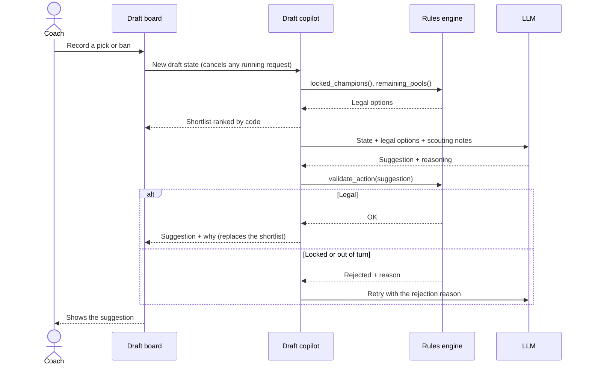

# Nimbus

**From scouting to the last pick of the series: a coaching workspace for League of Legends esports, built for Fearless Draft.**

Nimbus helps professional *League of Legends* coaching staffs prepare for and run a Fearless Draft series without spreadsheets. It combines a deterministic draft rules engine with AI agents that scout opponents and suggest picks and bans, and every suggestion is checked against the rules before it reaches the coach.

---

## Why Nimbus

In Fearless Draft, the format used in professional *League of Legends* series, a champion picked in one game of a series is locked for the remaining games. Over a best-of-five, every pick you make today shrinks your options tomorrow, and your opponent's options shrink too. Coaches currently track this by hand in spreadsheets, while also preparing scouting notes in separate documents.

Nimbus brings both moments of the coach's job into one place:

| Phase | Module | What it does |
|---|---|---|
| **Before the series** | **Nimbus Scout** | An AI agent analyzes the opponent's match data and writes a scouting report. |
| **During the series** | **Nimbus Draft** | A Fearless-aware draft board with an AI copilot that suggests picks and bans. |

What Scout learns about the opponent feeds directly into Draft's suggestions.

---

## Features

Everything below is planned for the first release and built in the order shown under [Project status](#project-status).

### Nimbus Draft: Fearless draft room
- **Fearless rules engine.** Shows which champions are locked in every game of a series. Each series chooses its Fearless variant, by which teams a lock applies to and whether it comes from picks only or from picks and bans:
  - *Off*: nothing carries over.
  - *Soft Fearless*: a champion is locked only for the team that picked it.
  - *Hard Fearless*: a champion picked in an earlier game is locked for **both** teams.
  - *Custom*: other combinations, for scrim formats (a lock on the picking team only cannot come from bans).
- **Disabled champions.** Champions a league has switched off can be disabled per series, pre-filled from a current list.
- **Manual live entry.** The analyst enters picks and bans by hand. There is no live feed from the game. A countdown timer run by Nimbus comes after the MVP.
- **Corrections and overrides.** Any pick or ban can be corrected at any time, even in an earlier game, and the latest entry of the current game can be undone, with an edit history. An entry that breaks a rule is rejected unless the analyst overrides it with a reason, and conflicts that appear later are flagged, never changed automatically.
- **Side and draft position.** Recorded separately for each game, along with First Selection, so blue side is not assumed to pick first.
- **Champion pools.** A declared pool for each of your players and an estimated, observed pool for opponents, showing how much of each is **remaining** for the series and **available now** in the current draft. A champion stops being remaining when a Fearless lock applies to the player's team or the champion is disabled, whoever played it (e.g. *mid laner: 6 champions in pool, 4 remaining, 2 available now*).
- **Draft copilot.** Shows a ranked shortlist computed by code as soon as the draft changes, then an AI reranking with reasons, up to three options. Without a language model the shortlist still works. The coach can flag champions (priority, avoid, ban target, save for a later game) and leave short notes. It suggests the next pick or ban and explains why. The copilot never decides legality itself: it queries the rules engine through tool calls, so it cannot recommend a locked champion. It says when it relies on general knowledge instead of your data, and when it has little data on a champion.
- **Series timeline.** Game-by-game view of picks, bans, locked champions and what is still missing from each game's record.

### Nimbus Scout: opponent scouting
- **Opponent statistics.** Most-picked and most-banned champions, pick and role priority, and draft position patterns for a chosen opponent, by default over their last 20 official games. Side patterns and First Selection choices arrive with the scouting report.
- **Automated scouting report.** An AI agent writes up what the data shows. Numbers are computed by code, never by the model; its interpretations are marked as such and cite the statistics behind them. Saved reports keep their numbers and flag where newer data has changed materially.
- **Ask the report.** Follow-up questions in natural language, answered by an agent that queries the underlying data.
- **Opponent pool forecasting.** What the opponent likely has left for games 4 and 5.
- **English or Brazilian Portuguese.** Reports and copilot explanations can be written in either, English first; the interface is in English.

### Multi-title by design
The rules engine has no title hard-coded into it. Everything title-specific lives in a **Title profile**: a data file that describes the title, and the engine reads it.

| Setting | League of Legends | Deadlock *(after the first release)* |
|---|---|---|
| Players per team | 5 | 6 |
| Character catalog | Champions | Heroes |
| Draft order | Official pro draft order | Whatever the tournament defines |
| Fearless presets | Off, Soft, Hard | To be defined |

A profile supplies defaults and presets. Each series chooses its own format (e.g. Bo3 or a fixed number of games), draft order (from those the profile names) and Fearless variant, and keeps a copy of those settings, so editing a profile never changes past series.

League of Legends is the first and main profile. Deadlock comes after the first release: its competitive scene is community-run and each tournament defines its own draft format, so a configurable draft tool fills a real gap.

### After the first release
- Deadlock Title profile.
- Export the draft plan (PDF/image) for team meetings.
- Accounts and multiple users.

Smaller ideas are collected in [`docs/future-ideas.md`](docs/future-ideas.md).

---

## Architecture

### System overview

```mermaid
flowchart TB
    U(["Coach / analyst"])

    subgraph FE["Frontend · React"]
        direction LR
        DB["Draft board"] ~~~ TL["Series timeline"] ~~~ SR["Scouting report"]
    end

    subgraph BE["Backend · Python / FastAPI"]
        API["REST API"]
        subgraph CORE["Deterministic core"]
            direction LR
            ENG[["Fearless rules engine"]]
            POOL["Pool tracker"]
        end
        PROF[("Title profiles<br/>LoL · Deadlock later")]
        subgraph AG["AI agents"]
            direction LR
            SC["Scout agent"]
            CP["Draft copilot"]
        end
        STORE[("Series store")]
        DATA[("Match data<br/>CSV · APIs")]
    end

    LLM{{"LLM provider"}}

    U --> FE
    FE -->|"HTTP / JSON"| API
    API -->|"manual picks & bans"| CORE
    API -->|"reports & suggestions"| AG
    AG -->|"tool calls"| CORE
    AG -->|"tool calls"| DATA
    CORE --> STORE
    PROF -->|"rules & characters"| CORE
    AG <-.->|"prompts"| LLM

    classDef rules fill:#F2A33A,stroke:#B8741C,color:#0B1220
    classDef ai fill:#5BB8F5,stroke:#2E86C1,color:#0B1220
    class ENG,POOL,PROF rules
    class SC,CP ai
```



Amber = deterministic code. Blue = AI. The agents never write draft state directly: every action goes through the core. Nimbus runs locally and serves a single coaching staff: it listens only on your own machine and has no login. The language model can be Claude or a local model; with a hosted one, the data it needs (draft state, statistics, champion pools, notes, team and player names) leaves your machine. Each series has a cost limit.

Data is kept in an unencrypted SQLite database on your machine (by default in `~/.local/share/nimbus`), with backups. Use your operating system's disk encryption to protect it.

### How a suggestion is made



**Design principle:** rules are code, judgment is AI. Legality (what can be picked) is decided by a deterministic, unit-tested engine. The language model handles reasoning and explanation, and it can only act through tools that the engine validates. The analyst can override a game rule to record what happened on stage; the copilot never can.

The vocabulary is defined in [`CONTEXT.md`](CONTEXT.md) and the architecture decisions in [`docs/adr/`](docs/adr/).

---

## Data

- **CSV import** for team rosters, champion pools, and match history (picks and bans). Imports are previewed before anything is written, and importing the same games again updates them instead of duplicating them.
- **Esports data API**: an optional second way to import past matches, added as the last milestone of the first release and subject to the provider's access terms.

---

## Getting started

Python 3.12+, uv, and Node.js 20.19+ are required. Run from this repository; no LLM or API key is needed for manual drafting.

```bash
uv sync
cd frontend
npm ci
npx playwright install chromium
cd ..
```

Start the backend from the repository root:

```bash
uv run nimbus
```

In a second terminal:

```bash
cd frontend
npm run dev
```

Open http://127.0.0.1:5173. Both servers bind loopback only. Data defaults to
`~/.local/share/nimbus/nimbus.sqlite3` (or `$XDG_DATA_HOME/nimbus`). Set
`NIMBUS_DATA_DIR` to choose another folder. Under WSL use a Linux folder;
startup warns for `/mnt/` storage. The SQLite database is **not encrypted**.

For a Windows browser with the servers in WSL2, open `http://localhost:5173`.
See [local access and concurrent tabs](docs/development/local-access.md) for the
supported setup, request contract, and two-tab verification.

### Verification

From the repository root:

```bash
uv run pytest
uv run mypy
uv run ruff check src scripts tests
uv run ruff format --check src scripts tests
cd frontend
npm run build
npm test
```

Playwright starts isolated backend/frontend servers on ports 8000 and 5173;
stop running development servers first. Its database is temporary.

### Character Catalog

The text-only catalog records its Data Dragon version. To update, choose an
explicit Riot Data Dragon version and review the YAML diff:

```bash
uv run python scripts/generate_catalog.py --version 16.23.1
```

The generator downloads JSON only, writes ids, names and aliases, and preserves
manual fields, retirement decisions, and missing Characters. Absence from a
release does not automatically retire a Character: review that decision manually.
When id and display name differ, both are aliases (MonkeyKing/Wukong).
No images or art are downloaded or stored.

### Current slice

Create a Best-of-5 Hard Fearless Series, record each Game's Side and Draft
Position, and enter a draft. Earlier picks lock for both Teams in the next Game.
The timeline preserves entries; an attempted locked pick explains its rejection.
Duplicate enforcement, locked-ban enforcement, results, assignments, overrides,
and other formats are later tickets. Snapshot settings retain the profile defaults.

---

## How it's built

Nimbus is developed with an agentic, spec-driven workflow:

| Tool | Role |
|---|---|
| **Claude Code** | Planning and review: specs, tickets, code reviews. |
| **Codex** | Execution: tickets implemented in parallel, each in its own Git worktree, reviewed before merging. |
| **[SAIL Skills](https://github.com/SAIL-PUC-Rio/Agentic-Software-Engineering-Skills)** | Shared process for all agents: spec → tickets → test-first implementation → evidence → review. |

The story of the workflow, including which agent handled which task and how much it cost, is recorded in [`AI_SHOWCASE.md`](AI_SHOWCASE.md) as the project is built.

---

## Project status

Walking skeleton implemented; subsequent MVP slices are in progress.

**MVP** (see [`docs/mvp-scope.md`](docs/mvp-scope.md))
- [x] 1. Walking skeleton: League of Legends profile, a series, one game's draft entered by hand, Fearless locks in game 2, through the real UI and API
- [ ] 2. Draft board and data: test-only second profile, corrections, overrides, timeline, CSV import, champion pools, opponent statistics
- [ ] 3. Draft copilot: latency prototype first, then code shortlist plus language model, in English

The core idea counts as proven at the end of milestone 3.

**Rest of the first release**
- [ ] Brazilian Portuguese output
- [ ] 4. Scouting report and "Ask the report"
- [ ] Countdown timer
- [ ] 5. Opponent pool forecasting
- [ ] 6. External data API import
- [ ] Demo video

**Later**
- [ ] Deadlock profile
- [ ] Draft plan export
- [ ] Accounts and multiple users

---

## License

Released under the [MIT License](LICENSE).

## Legal

Nimbus isn't endorsed by Riot Games and doesn't reflect the views or opinions of Riot Games or anyone officially involved in producing or managing Riot Games properties. Riot Games, and all associated properties are trademarks or registered trademarks of Riot Games, Inc.

Deadlock is a trademark of Valve Corporation. Nimbus is not affiliated with or endorsed by Valve.

Nimbus is an independent project and is not affiliated with any esports organization.
