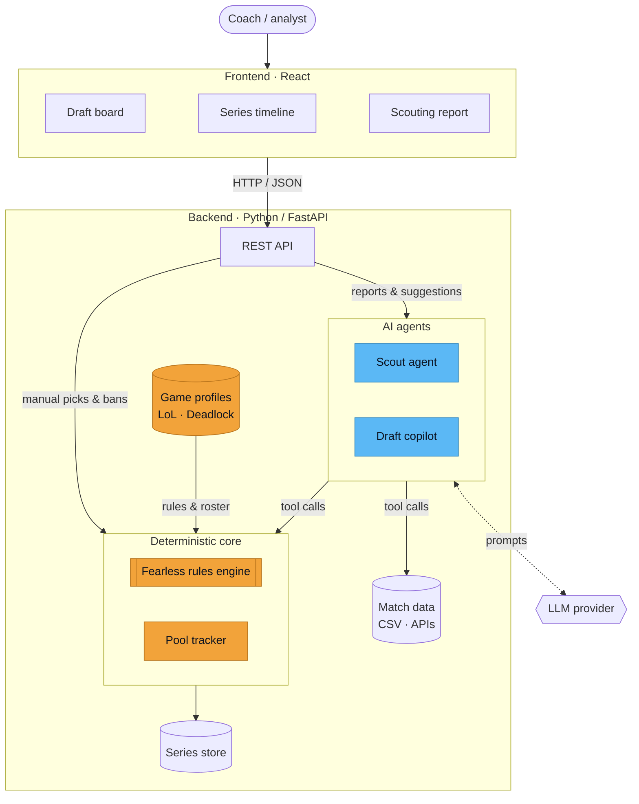
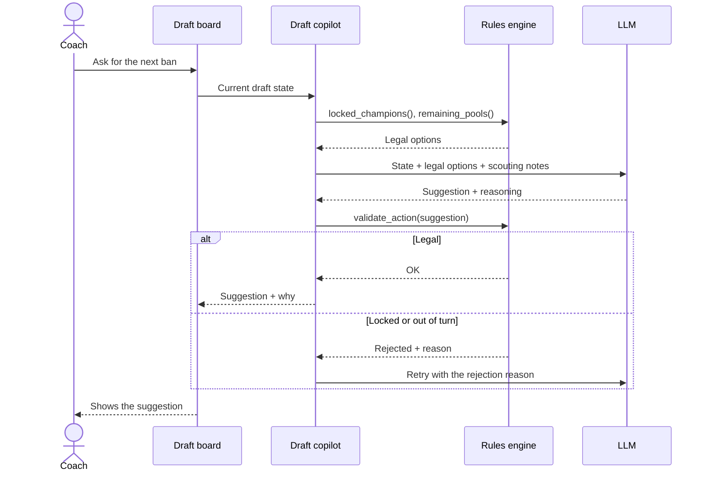

# Nimbus

**From scouting to the last pick of the series: a coaching workspace for League of Legends esports, built for Fearless Draft.**

Nimbus helps professional *League of Legends* coaching staffs prepare for and run a Fearless Draft series without spreadsheets. It combines a deterministic draft rules engine with AI agents that scout opponents and suggest picks and bans, and every suggestion is checked against the rules before it reaches the coach.

---

## Why Nimbus

In Fearless Draft, the format used in professional *League of Legends* series, a champion played in one game of a series is locked for the remaining games. Over a best-of-five, every pick you make today shrinks your options tomorrow, and your opponent's options shrink too. Coaches currently track this by hand in spreadsheets, while also preparing scouting notes in separate documents.

Nimbus brings both moments of the coach's job into one place:

| Phase | Module | What it does |
|---|---|---|
| **Before the series** | **Nimbus Scout** | An AI agent analyzes the opponent's match data and writes a scouting report. |
| **During the series** | **Nimbus Draft** | A Fearless-aware draft board with an AI copilot that suggests picks and bans. |

What Scout learns about the opponent feeds directly into Draft's suggestions.

---

## Features

### Nimbus Draft: Fearless draft room
- **Fearless rules engine.** Tracks picks and bans for every game of a series and shows which champions are locked. Supports configurable rule variants:
  - *Hard Fearless*: a champion picked in an earlier game is locked for **both** teams.
  - *Soft Fearless*: a champion is locked only for the team that picked it.
- **Champion pools.** Each player's pool, with how much of it remains available in the current series (e.g. *mid laner: 6 champions in pool, 3 used, 3 remaining*).
- **Draft copilot.** Suggests the next pick or ban and explains why. The copilot never decides legality itself: it queries the rules engine through tool calls, so it cannot recommend a locked champion.
- **Series timeline.** Game-by-game view of picks, bans, and locked champions.

### Nimbus Scout: opponent scouting
- **Automated scouting report.** Most-picked and most-banned champions, pick priority, and side-specific patterns for a chosen opponent.
- **Ask the report** *(planned)*. Follow-up questions in natural language, answered by an agent that queries the underlying data.

### Multi-game by design
The rules engine has no game hard-coded into it. Everything game-specific lives in a **game profile**: a data file that describes the game, and the engine reads it.

| Setting | League of Legends | Deadlock *(planned)* |
|---|---|---|
| Players per team | 5 | 6 |
| Roster | Champions | Heroes |
| Pick/ban order | Official pro draft order | Whatever the tournament defines |
| Fearless rule | Hard or soft | On or off |

League of Legends is the first and main profile. Deadlock comes next: its competitive scene is community-run and each tournament defines its own draft format, so a configurable draft tool fills a real gap.

### Planned
- Deadlock game profile.
- Export the draft plan (PDF/image) for team meetings.
- Opponent pool forecasting: predict what the opponent has left for games 4 and 5.

---

## Architecture

### System overview



Amber = deterministic code. Blue = AI. The agents never write draft state directly: every action goes through the core.

### How a suggestion is made



**Design principle:** rules are code, judgment is AI. Legality (what can be picked) is decided by a deterministic, unit-tested engine. The language model handles reasoning and explanation, and it can only act through tools that the engine validates.

---

## Data

- **CSV import** for rosters, champion pools, and match history (picks and bans).
- **Esports data APIs** *(planned)*: optional integration with a professional match data provider.

---

## Getting started

> Work in progress. Setup instructions will be completed as the project is built.

### Requirements
- Python 3.12+ with [uv](https://docs.astral.sh/uv/)
- Node.js 20+
- An API key for the LLM provider (see `.env.example`)

### Backend
```bash
cd backend
uv sync
cp .env.example .env   # fill in your keys
uv run fastapi dev app/main.py
```

### Frontend
```bash
cd frontend
npm install
npm run dev
```

### Tests
```bash
cd backend
uv run pytest
```

---

## How it's built

Nimbus is developed with an agentic, spec-driven workflow:

| Tool | Role |
|---|---|
| **Claude Code** | Planning and review: specs, tickets, code reviews. |
| **Codex** | Execution: tickets implemented in parallel, each in its own Git worktree, reviewed before merging. |
| **[SAIL Skills](https://github.com/SAIL-PUC-Rio/Agentic-Software-Engineering-Skills)** | Shared process for all agents: spec → tickets → test-first implementation → evidence → review. |

The full story of the workflow, including which agent handled which task and how much it cost, is in [`AI_SHOWCASE.md`](AI_SHOWCASE.md).

---

## Project status

- [ ] Game profile format + League of Legends profile
- [ ] Fearless rules engine + tests
- [ ] Champion pools and series tracking
- [ ] Draft board UI
- [ ] Draft copilot (tool-calling agent)
- [ ] CSV import (rosters, pools, match history)
- [ ] Scouting report agent
- [ ] Deadlock profile
- [ ] Demo video

---

## License

Released under the [MIT License](LICENSE).

## Legal

Nimbus isn't endorsed by Riot Games and doesn't reflect the views or opinions of Riot Games or anyone officially involved in producing or managing Riot Games properties. Riot Games, and all associated properties are trademarks or registered trademarks of Riot Games, Inc.

Deadlock is a trademark of Valve Corporation. Nimbus is not affiliated with or endorsed by Valve.

Nimbus is an independent project and is not affiliated with any esports organization.
